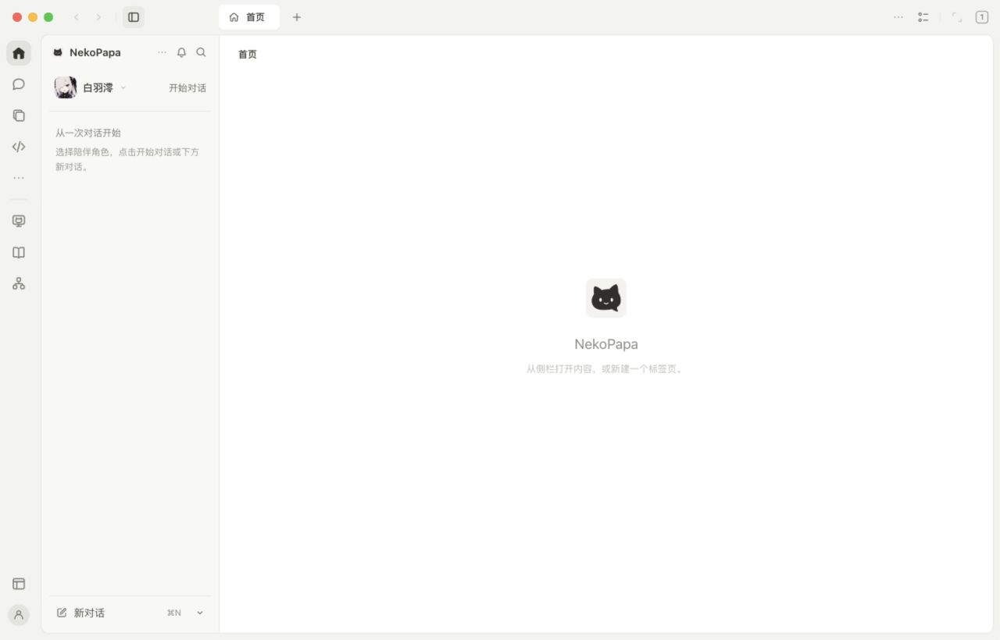
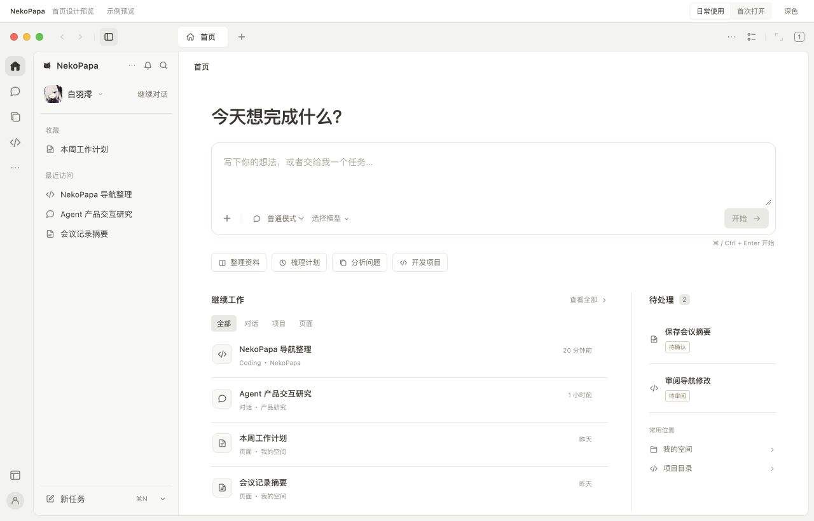

# NekoPapa

一个正在开发的 AI 桌面伙伴。

我们希望 NekoPapa 既能陪你聊日常，也能在需要时帮你处理代码项目。聊天、项目和整理好的内容都放在一个桌面应用里，方便下次继续。

[界面预览](#界面预览) · [从源码运行](#从源码运行) · [开发计划](#开发计划) · [文档](docs/README.md) · [反馈问题](https://github.com/Hisakazu333/NekoPapa/issues)

> [!NOTE]
> 当前版本为 `0.1.0`，处于早期开发阶段。角色选择、多标签、内容管理和设置已经可用；聊天、Live2D、Pi 编程和官方账号服务尚未接入。

## 界面预览



当前界面的浏览器预览，截图来自独立验证环境。

<details>
<summary>正在设计的首页</summary>



首页原型使用示例数据，展示任务输入、最近工作和待处理事项。它可以独立运行，目前尚未接入主窗口和 Agent 执行。运行方法见 [首页设计预览](prototypes/home/README.md)。

</details>

## 目前可以体验

- **选择角色**：切换白羽澪、雪代凛音等五位角色，创建或重新打开对应的会话入口。已有会话保留原来的角色。
- **管理标签**：在多个内容之间切换、查找和排序。关闭标签后，仍可以从侧栏重新打开内容。
- **整理工作台**：新建、重命名、移动、收藏和搜索内容入口；归档暂时不用的内容，删除后可从回收站恢复。
- **调整外观**：切换浅色 / 深色主题，调整侧栏宽度、布局和列表显示数量。
- **保存设置**：编辑本机资料、模型与工具配置，取消未保存的修改，导出和恢复配置备份。

目前保存的是工作台索引、布局和设置，聊天与页面正文还在开发中。具体操作见 [界面操作说明](docs/navigation-map.md)。

## 从源码运行

客户端使用 TypeScript、Vite 和 Tauri 2，原生宿主使用 Rust。当前开发和原生验证以 macOS Apple Silicon 为主，Windows / Linux 尚待验证。

运行桌面客户端需要：

- Node.js `^20.19.0 || >=22.12.0` 和 npm。
- Rust stable 及 [Tauri 平台构建依赖](https://v2.tauri.app/start/prerequisites/)。macOS 需要 Xcode 开发工具。

```bash
git clone https://github.com/Hisakazu333/NekoPapa.git
cd NekoPapa
npm ci
npm run desktop
```

单独在浏览器中预览界面，只需 Node.js 和 npm。安装依赖后运行：

```bash
npm run dev
```

打开 `http://127.0.0.1:1420`。浏览器与桌面客户端分别保存各自的工作台数据。

构建桌面应用：

```bash
npm run desktop:build
```

当前打包配置生成 macOS `.app`，输出为 `src-tauri/target/release/bundle/macos/NekoPapa.app`。正式发行的签名与公证尚未配置。

## 账号与云服务

NekoPapa 使用自己的账号与云端服务。官方账号、云点和计费后端不包含在本仓库中。

模型接入计划提供两种方式：

- **官方云服务**：登录 NekoPapa 账号，使用官方提供的模型服务，通过云点结算。
- **自定义 API**：配置自己的服务地址和模型，由 API 提供方计费；使用这条路径无需登录官方账号。

两种方式都还在开发，目前仅支持保存相关配置。完整说明见 [模型与账号设置](docs/settings-map.md)。

## 开发计划

- [x] 桌面界面、角色选择、多标签和工作台管理。
- [x] 本机设置、外观调整和配置备份。
- [ ] 真实聊天：流式回复、停止、重试，以及重启后继续对话。
- [ ] Live2D 桌面角色：独立透明窗口、拖动、隐藏和角色反馈。
- [ ] Pi Coding：选择本地项目，读取、修改代码并执行验证。
- [ ] 记忆与页面：管理角色记忆，把有用的结果保存成可编辑内容。
- [ ] 工作流与定时任务：复用常用步骤，查看执行过程和结果。
- [ ] 官方账号与模型服务接入。

具体开发顺序见 [迭代计划](docs/iteration-plan.md)，模块和任务见 [开发清单](docs/iteration-backlog.md)。

## 参与贡献

欢迎提交问题、文档修正和代码改进。

报告问题时，请在 [Issues](https://github.com/Hisakazu333/NekoPapa/issues) 中附上操作系统、应用版本、复现步骤，以及预期和实际结果；界面问题可以附截图。

修改前端代码后，请运行：

```bash
npm run test
npm run build
```

涉及 Rust 或原生能力时，追加：

```bash
cargo check --manifest-path src-tauri/Cargo.toml
cargo test --manifest-path src-tauri/Cargo.toml
npm run desktop:build -- --debug
```

代码结构和修改约定见 [AGENTS.md](AGENTS.md)，技术设计见 [架构文档](docs/architecture.md)。各次测试与界面检查记录在 [验收记录](docs/navigation-contract.md) 中，其他文档见 [文档目录](docs/README.md)。

## 许可证

本仓库的客户端代码采用 [Apache License 2.0](LICENSE)。你可以按许可证要求使用、修改和分发代码；官方账号与云服务由我们运营。

Pi Coding 计划接入 [Pi Coding Agent](https://pi.dev/)，其代码使用 [MIT 许可证](https://github.com/earendil-works/pi/blob/76dfb88f63ce51ff2e3fe2ead4fcf1f65f71f121/LICENSE)。

Logo 和人物资源的来源见 [Logo 说明](docs/brand/nekopapa-logo.md) 与 [人物头像说明](docs/brand/lumia-avatar.md)。人物插画、Live2D 模型和 SDK 的使用与分发需遵守各自的授权条款。
