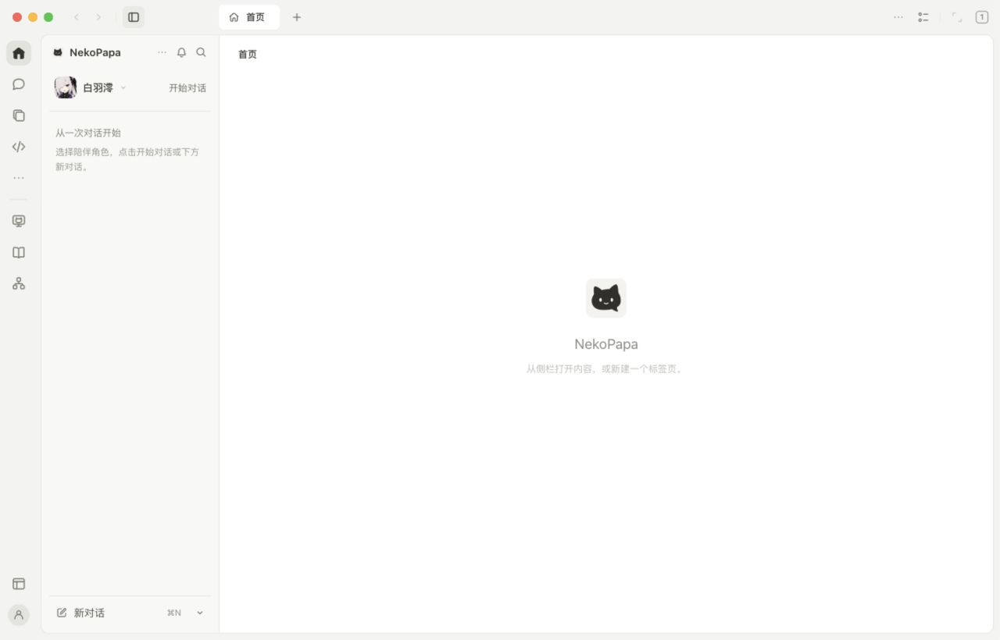
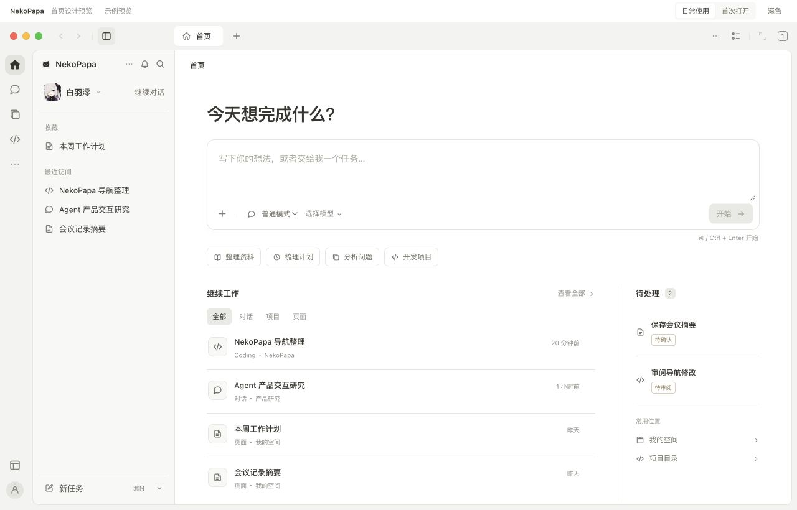

# NekoPapa

一个正在开发的 AI 桌面伙伴。

我们希望 NekoPapa 既能陪你聊日常，也能在需要时帮你处理代码项目。聊天、项目和整理好的内容都放在一个桌面应用里，方便下次继续。

[界面预览](#界面预览) · [从源码运行](#从源码运行) · [开发计划](#开发计划) · [文档](docs/README.md) · [反馈问题](https://github.com/Hisakazu333/NekoPapa/issues)

> [!NOTE]
> 当前版本为 `0.1.0`，正在重做主要工作区。当前入口提供工作台、联系人聊天和本机设置；模型调用需要配置开发服务器环境。桌面应用中归入项目的工作台对话可以让模型读、搜、改项目文件和运行命令（按权限模式审批，改动可撤销）；子任务、自动路由、官方人物聊天与教育执行服务仍待接入。

## 界面预览

`npm run dev` 后，根路径和 `/chat.html` 使用同一个 React 入口。界面以官方 BoardUI Chat Starter 源码为基础，按 NekoPapa 的工作台和联系人流程重新组织；安装记录与改动边界见 [BoardUI 源码说明](src/components/boardui-source.md)。

侧栏保留“工作台”“联系人”和底部账号入口。工作台首页使用猫图标、衬线问候、大文本输入区、工具区和快捷提示；联系人页在主区展示紧凑的联系人列表与连续聊天，新增入口位于列表顶部。当前界面不再使用此前的多标签工作台作为入口。

<details>
<summary>历史工作台截图</summary>



这张截图记录此前导航壳，来自独立验证环境；对应源代码与历史数据保留，不代表当前页面布局或当前入口可用功能。

</details>

<details>
<summary>历史首页原型</summary>



该独立原型使用示例数据，记录此前任务首页的设计过程，不是当前聊天首页，也没有接入 Agent 执行。运行方法见 [首页设计预览](prototypes/home/README.md)。

</details>

## 目前可以体验

- **工作台对话**：编写多行消息，用解释、写作、计划和研究快捷提示填入草稿。输入框下层的模式与联系人选择并列：未选择联系人时默认 Auto，可选 Auto、聊天、学习、Agent；Agent 统一涵盖通用任务与 Coding。选择联系人后留在工作台并沿用其聊天记录，自建联系人可选聊天、学习、专业协助，官方人物默认聊天且仅提供聊天、学习。
- **联系人聊天**：在主区搜索五位官方同伴和自建联系人，从列表顶部新增；选择联系人后开始或继续其连续对话，保留原聊天 ID。官方预设、我的联系人和群聊支持展开收起；搜索临时展开匹配分组，清除搜索后恢复偏好。
- **聊天输入区**：输入框内放置附件、权限模式（仅工作台，每次询问 / 自动接受编辑 / 仅计划 / 完全访问）、模型选择和发送；工作台不选模式、始终自动路由，联系人单聊保留模式菜单。模型菜单只列真实配置，使用 42px 供应商图标栏与紧凑模型行，支持搜索和管理模型；表情在光标处插入。工作台与自建联系人可暂存文件、目标、计划及文档、表格、演示、代码输出选择；官方人物只保留文件资料入口。回复按 Markdown（表格、任务列表、KaTeX 公式）呈现，代码块按语言高亮，` ```mermaid ` 画流程图，` ```chart ` JSON 画柱 / 线 / 面积 / 饼图。归入项目的工作台对话在桌面应用中带上项目文件夹与权限模式：模型可列目录、读取、搜索、写入 / 修改文件、运行命令并维护任务清单，对话中显示工具行、审批卡、改动差异卡（可撤销）、命令输出卡和任务进度卡（见 [本机数据](docs/local-data-model.md) 与 [架构](docs/architecture.md)）；浏览器预览没有这些工具，模型会如实说明。自动路由、学习、附件发送和文件生成尚未接入，相应草稿状态明确阻止发送。
- **对话 / 轨迹**：对话有消息后，顶部可在“对话”和“轨迹”之间切换。轨迹按顺序列出用户消息、模型回复、思考和工具调用，显示步骤与工具耗时、Token 统计和“输入 / 模型 / 工具”时间轴，可筛选、搜索、展开查看参数与结果，并跳回对话中的对应消息。耗时随回复保存在 `metadata.trace`，此前生成的回复只显示步骤列表。
- **自建联系人头像**：新建或编辑时点击头像导入 PNG、JPG、WebP（最大 5 MB），本机自动居中裁剪并预览；支持更换、移除，保存后显示在列表与聊天中，取消保留原头像。图片保存在本机，不随联系人设定发送给模型。
- **联系人设定**：自建联系人可配置专业提示词并参加群聊；五位官方人物的人设由 Java 后端管理，桌面端只保留公开资料，用户不能编辑提示词，仅用于单人陪伴聊天和学习。当前 Java 人物服务与学习模式尚未接入，官方人物发送明确禁用；通用模型配置不会使官方服务变为可用。接入边界见 [Java 人物服务](docs/official-companion-service.md)。
- **删除自建联系人**：从联系人行的更多菜单、右键菜单或聊天页的更多菜单删除；确认后删除该联系人及其单独聊天，已有群聊保留。取消不改动记录，失败说明保留状态并提供明确重试；官方联系人不提供删除入口。
- **删除群聊**：从群聊行或聊天页的更多菜单删除，确认后移除该群及其聊天记录；失败保留原记录并可重试。包含官方人物的旧群聊可查看或删除，停止发送与续写；删除不影响联系人及其单独聊天。
- **切换时继续编写**：联系人各自保留当前页面中的输入草稿和流式状态，工作台对话独立；切换联系人或返回工作台不会重建已打开的联系人组件。
- **项目文件**：点标题栏的“文件”按钮（`⇧⌘F`），切换同一项目的源文件夹，文件树按类型显示图标并标出 Git 更改，预览和差异按语言语法高亮，可复制路径，桌面端可用外部编辑器打开。
- **浏览历史**：工作台右侧辅助区显示其聊天历史，支持拖动分隔条调整宽度；联系人从自己的列表继续最近对话。
- **账号小屋**：桌面端从小屋进入账号登录页；登录后读取当前同伴，向 Java 申请 OSS 模型包签名，验证大小和 SHA-256，再在房间中显示真实模型。可打开账号同伴名册，查看等级、默契，预览已开放同伴并返回当前绑定。
- **管理本机设置**：30 个设置分类管理个人资料、外观、模型、工具、设备、开发偏好和备份；登录从账号菜单进入独立页面，主题可切换浅色、深色或跟随系统。

聊天正文使用共享 `ChatHistoryStore` 按 ID 合并保存到浏览器存储，避免工作台与联系人互相覆盖；损坏读取会阻止覆盖原件，保存失败提供重试。输入草稿与进行中的流式执行仍属于当前页面，不承诺重载后自动恢复。此存储尚不是数据库，也不代表原生多窗口一致性已验收。具体操作与历史功能边界见 [界面操作说明](docs/navigation-map.md)。

未连接模型时可编辑草稿，发送按钮禁用，不生成脚本回复。Vite 开发 / 预览服务器已适配真实模型 API 协议，但本轮没有宣称已完成真实提供方问答验收。Tauri 静态安装包还需要独立的常驻服务接入。

## 从源码运行

当前界面使用 TypeScript、React 和 Vite，桌面宿主为 Tauri 2 / Rust。当前开发以 macOS Apple Silicon 为主，Windows / Linux 尚待验证。

运行桌面客户端需要：

- Node.js `^20.19.0 || >=22.12.0` 和 npm。
- Rust stable 及 [Tauri 平台构建依赖](https://v2.tauri.app/start/prerequisites/)。macOS 需要 Xcode 开发工具。
- macOS 小屋还需 CMake 和同级 `NekoCore-Nano` 源码。若 SDK 位于其他目录，构建时设置 `NEKOCORE_NANO_PATH`。

```bash
git clone https://github.com/Hisakazu333/NekoPapa.git
cd NekoPapa
npm ci
npm run desktop
```

`npm run desktop` 构建并打开本地 macOS release 应用，账号服务指向 `http://127.0.0.1:8080`。

单独在浏览器中预览界面，只需 Node.js 和 npm。安装依赖后运行：

```bash
npm run dev
```

打开 `http://127.0.0.1:1420`。浏览器与桌面 WebView 分别使用各自的本机存储，不能视作自动同步。桌面应用的聊天记录保存在系统应用数据目录（macOS：`~/Library/Application Support/app.nekopapa.desktop/data/workspace.sqlite`，SQLite），首次启动时从 WebView 存储（以及上一版的 `chat-threads.json`）迁移，原副本保留为备份；快速搜索会查找全部消息正文；浏览器预览仍使用浏览器存储。

开发 / 预览服务器的聊天路由读取服务器环境中的模型配置，例如 `AI_PROVIDER`、`AI_API_KEY`、`AI_BASE_URL` 和 `CHAT_MODEL`；具体支持项见 [路由源码](src/app/api/chat/route.ts)。也可以在设置的“模型与 API”中配置服务地址、凭据和多个模型，再从聊天输入区选择。API Key 由宿主读取系统钥匙串，浏览器开发服务器使用环境变量。

构建桌面应用：

```bash
npm run desktop:build
```

常规打包配置生成 macOS `.app`，输出为 `src-tauri/target/release/bundle/macos/NekoPapa.app`。

### 桌面分发构建

在已配置签名的 macOS 或 Windows 原生发布执行机上运行 `npm run desktop:build:distribution`。先准备平台构建工具和依赖（`npm ci`），macOS 同时准备上文所述的 NekoCore-Nano。发布任务只从受信任的源码构建，证书与私钥由发布执行机或 CI 的受保护凭据注入。

- 两个平台都设置 `NEKOPAPA_ACCOUNT_API_URL`（HTTPS）、`NEKOPAPA_BUILD_NUMBER`（正整数）和 `NEKOPAPA_RELEASE_CHANNEL`（`stable` 或 `beta`）。
- macOS 执行机的钥匙串安装 Developer ID Application 证书和私钥。设置 `APPLE_SIGNING_IDENTITY`（完整证书名称）、`APPLE_API_ISSUER`、`APPLE_API_KEY` 及 `APPLE_API_KEY_PATH`，由 Tauri 公证并附加票据。脚本验证签名团队、应用标识、附加票据和 Gatekeeper，再将 `.app` 封装为 ZIP。[Tauri macOS 签名](https://v2.tauri.app/distribute/sign/macos/)
- Windows 执行机准备 Windows SDK SignTool，并将可用的签名证书及私钥配置到运行账号的 `CurrentUser\My` 证书库。设置 `NEKOPAPA_WINDOWS_CERT_THUMBPRINT`、`NEKOPAPA_WINDOWS_TIMESTAMP_URL`（HTTPS RFC 3161）和可选的 `NEKOPAPA_SIGNTOOL`（SignTool 路径）。脚本签名并校验 Tauri 要打入 NSIS 安装包的程序及最终安装包。[Tauri Windows 签名](https://v2.tauri.app/distribute/sign/windows/) · [Microsoft SignTool](https://learn.microsoft.com/windows/win32/seccrypto/signtool)

签名、公证或校验失败会中止分发构建。CI 只收集命令打印的当前 `.local/distribution/` 下的 ZIP 或 NSIS 安装包。该次调试符号写入独立的 `.local/distribution-symbols/`，只归档到受限存储。

本地 release 默认使用临时签名。可用 `APPLE_SIGNING_IDENTITY` 指定钥匙串中的 Apple Development 签名身份。

## 账号与云服务

NekoPapa 使用自己的账号与云端服务。官方账号、云点和计费后端不包含在本仓库中。

模型接入计划提供两种方式：

- **官方云服务**：登录 NekoPapa 账号，使用官方提供的模型服务，通过云点结算。
- **自定义 API**：配置自己的服务地址和模型，由 API 提供方计费；使用这条路径无需登录官方账号。

桌面端账号支持密码、短信或 NekoBuddy 扫码登录，并用短信验证注册。release 包通过构建环境变量 `NEKOPAPA_ACCOUNT_API_URL` 选择 Java 账号服务。未配置时显示未连接状态。登录成功后自动返回调用处，保留当前会话和草稿。头像菜单的「个人资料」打开独立页面，可查看账号身份和本机活动，并编辑本机资料。登录后可从同一菜单选择「更换头像」。完整说明见 [模型与账号设置](docs/settings-map.md) 与 [Java 契约边界](docs/official-companion-service.md)。

在本机 Java 服务运行时，用 `npm run desktop` 构建并打开用于联调的 macOS release 包。也可只出包，之后从访达打开。线上 release 构建使用对应的 HTTPS 地址。

```bash
npm run desktop:build:local
```

本地 release 命令使用构建号 `1` 和 `dev` 渠道。构建线上包时传入 `NEKOPAPA_BUILD_NUMBER` 和 `NEKOPAPA_RELEASE_CHANNEL`。账号请求也携带 Tauri 包版本与 macOS 系统版本。Java 需要完整版本信息才会为设有最低版本的 Live2D 模型签发下载地址。

## 开发计划

- [x] 基于 BoardUI 的工作台和联系人界面、本机资料与设置入口。
- [x] 共享浏览器聊天历史、本机配置备份和主题切换。
- [ ] 真实提供方及桌面运行时端到端验收、可靠后台执行和重启恢复。
- [ ] Coding：选择本地项目，读取、修改代码并执行验证。
- [ ] 记忆与页面：管理角色记忆，把有用的结果保存成可编辑内容。
- [ ] 工作流与定时任务：复用常用步骤，查看执行过程和结果。
- [ ] 官方账号与模型服务接入。
- [ ] 个人自学：资料解释、独立作答、可追溯反馈、笔记和复习。

个人自学的范围与先后依赖见 [学习工作台规划](docs/self-learning-plan.md)；DeepTutor 为可选独立服务候选，当前未运行或接入，见 [接入评估](docs/deeptutor-integration.md)。原有 [迭代计划](docs/iteration-plan.md) 与 [开发清单](docs/iteration-backlog.md) 保留为运行时、持久化和后续能力的规划依据，实际完成状态应结合当前入口与本轮验收。

## 参与贡献

欢迎提交问题、文档修正和代码改进。

报告问题时，请在 [Issues](https://github.com/Hisakazu333/NekoPapa/issues) 中附上操作系统、应用版本、复现步骤，以及预期和实际结果；界面问题可以附截图。

修改前端代码后，请运行：

```bash
npm run test
npm run build
```

涉及 Rust 或原生能力时，追加：

```bash
cargo check --manifest-path src-tauri/Cargo.toml
cargo test --manifest-path src-tauri/Cargo.toml
npm run desktop:build:local
```

代码结构和修改约定见 [AGENTS.md](AGENTS.md)，技术设计见 [架构文档](docs/architecture.md)。各次测试与界面检查记录在 [验收记录](docs/navigation-contract.md) 中，其他文档见 [文档目录](docs/README.md)。

## 许可证

本仓库的客户端代码采用 [Apache License 2.0](LICENSE)。你可以按许可证要求使用、修改和分发代码；官方账号与云服务由我们运营。

Coding 执行引擎尚未选定（2026-11-10 起不再采用 Pi 方案）；选定并接入后在此补充来源与许可证。

Logo 和人物资源的来源见 [Logo 说明](docs/brand/nekopapa-logo.md) 与 [人物头像说明](docs/brand/lumia-avatar.md)。人物插画、Live2D 模型和 SDK 的使用与分发需遵守各自的授权条款。
