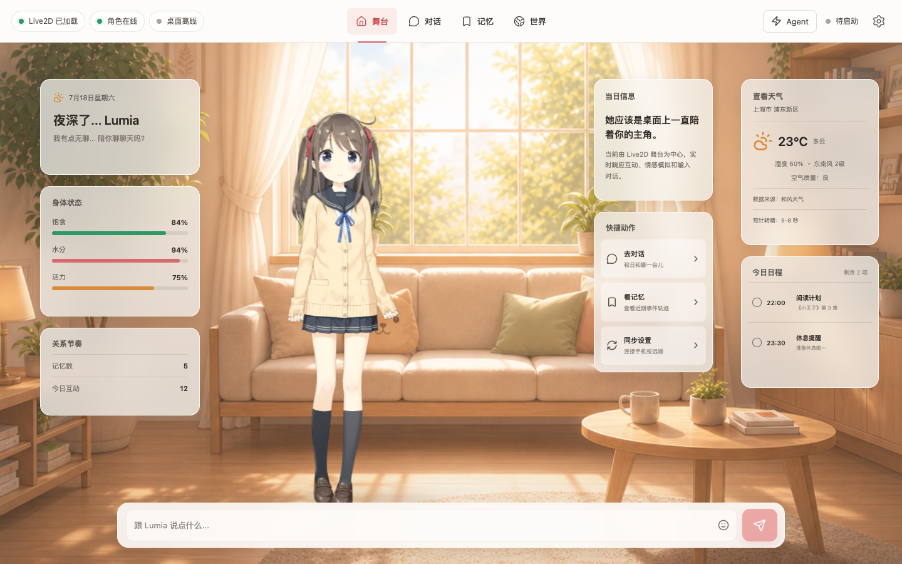

<p align="center">
  
</p>

<h1 align="center">NekoPapa</h1>

<p align="center">面向桌面陪伴与学习场景的 React + Tauri 客户端。</p>

<p align="center">
  <a href="https://github.com/Hisakazu333/NekoPapa/actions/workflows/ci.yml"></a>
  <a href="LICENSE"></a>
  
</p>

<p align="center"><a href="README_EN.md">English</a> · 简体中文</p>

NekoPapa 仓库负责产品 UI、Tauri 桌面宿主、Stage 进程管理和跨进程协议。NekoCore-Nano
与 Native Stage 的 C++ 实现位于外部原生仓库，本仓库不再复制其源码或 Cubism Native
SDK。桌面宿主通过预构建 sidecar 接入原生运行时。

> [!IMPORTANT]
> 项目仍处于开发预览阶段。本仓库不附带 Native Stage 二进制；没有兼容产物时，浏览器
> 预览可运行，但 Tauri 开发与打包会给出缺失 sidecar 的错误。

<p align="center">
  
</p>

## 当前状态

| 模块 | 已确认状态 | 边界 |
| --- | --- | --- |
| React 主窗口 | 开发中 | 页面、导航和预览数据位于 `app/control-desktop/` |
| 小屋 Live2D | 已接入开发模型 | Pixi.js + Cubism Web，在 WebView 或浏览器中渲染 |
| Tauri host | 基础生命周期已实现 | 启动、查询和停止固定 Native Stage sidecar |
| Native Stage | 外部依赖 | 本仓库没有实现或二进制；需按平台提供预构建可执行文件 |
| NekoCore | 待接入 | 本仓库没有核心源码，界面中的相关数据仍是占位或预览状态 |
| Stage Protocol v1 | 草案 | schema 与示例在仓库内；当前 host 仍保留最小 legacy v0 行为 |
| 对话、记忆、世界、Agent | 界面原型 | 尚无完整服务、权限和持久化闭环 |

CI 当前验证仓库卫生、文档链接、前端类型检查与构建，以及 Rust 格式、lint 和测试。
它不验证外部 Native Stage 的源码、GPU 运行或最终安装包。

## 快速开始

浏览器预览需要 Node.js 24 和 npm：

```bash
npm --prefix app/control-desktop ci
npm --prefix app/control-desktop run dev
```

打开 `http://127.0.0.1:1420/`。浏览器模式不会启动 sidecar，Stage 状态为模拟值。

### 运行 Tauri 桌面应用

除 Node.js 外，还需要 Rust 1.96+ 和对应平台的
[Tauri 2 依赖](https://v2.tauri.app/start/prerequisites/)。先提供与 Rust target triple
匹配的 Native Stage：

```bash
export NEKOPAPA_NATIVE_STAGE_BINARY=/absolute/path/to/nekopapa-native-stage
npm --prefix app/control-desktop run tauri -- dev
```

也可以按 [`native-prebuilt/`](native-prebuilt/README.md) 的目录约定放置产物。准备脚本会
将其复制为 Tauri 要求的 target-triple 文件名。单个 Android/HarmonyOS `.so` 不能替代
macOS 或 Windows 桌面 sidecar。

## 运行时边界

```text
React UI ── typed bridge ──> Tauri / Rust host ── process + JSONL ──> external Native Stage
    │
    └── Pixi.js / Cubism Web embedded canvas
```

- React 只管理页面、交互和短生命周期 UI 状态。
- Tauri 拥有窗口、权限、资源寻址和 sidecar 生命周期。
- 外部 Native Stage 拥有独立桌宠窗口、原生渲染和平台 C++ 依赖。
- `protocol/stage/v1/` 定义目标消息契约；协议兼容不由文件存在自动保证。

完整决策见 [ADR-0001](doc/architecture/adr/0001-external-native-stage.md) 和
[桌面运行时边界](doc/architecture/desktop-runtime-boundaries.md)。

## 仓库结构

| 路径 | 责任 |
| --- | --- |
| `app/control-desktop/` | React 主窗口与 Tauri/Rust 桌面宿主 |
| `prototype/desktop-app/` | 零构建产品 UI 设计基线 |
| `protocol/stage/v1/` | Native Stage JSONL v1 草案与 fixtures |
| `native-prebuilt/` | 外部桌面 sidecar 的本地交付约定，不提交实际二进制 |
| `assets/` | WebView 和打包所需运行时资产 |
| `doc/` | 产品、架构、开发和治理文档 |

## 参与开发

- [贡献指南](CONTRIBUTING.md)
- [开发环境](doc/contributing/development-environment.md)
- [文档中心](doc/README.md)
- [项目治理](GOVERNANCE.md)
- [安全策略](SECURITY.md)

## 许可证与第三方资产

仓库自有代码使用 [Apache License 2.0](LICENSE)。Live2D 示例模型、Cubism Web 依赖以及
外部 Native Stage 中的 SDK/运行库适用各自条款；外部二进制提供方必须随产物交付来源、
版本、校验和和许可清单。参见 [Live2D 资产说明](assets/live2d/README.md)。
