# NekoPapa 桌面端 Logo

当前版本：v1。使用 Codex 内置 imagegen 生成，未使用手机端 Logo 作为输入或素材。

猫头轮廓与对话气泡共用一个外形，表达陪伴和交流。深灰与暖白延续桌面主窗口的中性色；简化的眼睛和微笑适合 Dock、侧栏与浏览器图标。

## 文件与使用

- `../../public/brand/nekopapa-app-icon-v1.png`：选定的生成源图，保留原始 PNG 与透明通道。
- `../../public/brand/nekopapa-app-icon-v1-128.png`：Tauri CLI 导出的 128px 界面版本，侧栏显示为 20px，首页显示为 64px。
- `../../public/brand/nekopapa-favicon-v1.png`：32px 浏览器图标。
- `../../src-tauri/icons/nekopapa-v1/`：32px、64px、128px、256px、512px PNG 和 ICNS、ICO 图标，原生打包配置使用此目录。

旧占位图标仍保留在仓库中；当前界面和打包配置已切换到这个版本。

源图是生成的位图。以下尺寸由 Tauri CLI 从选定源图导出，未另画 SVG。

## 导出方式

```sh
npm run tauri -- icon public/brand/nekopapa-app-icon-v1.png --output .local/icon-build-neko-v1
```

选取导出目录内的桌面图标，复制到 `src-tauri/icons/nekopapa-v1/`。界面使用其中的 `128x128.png`，浏览器使用 `32x32.png`；项目当前只构建桌面 `.app`，不使用导出的移动端图标。

## 原始生成提示词

模式：内置 imagegen；`transparent_background: true`；没有输入参考图。

```text
Use case: logo-brand
Asset type: one original desktop application icon for NekoPapa, a calm personal companion and agent workspace.

Create a completely new logo from this description alone. Do not reference, recreate, or imitate any existing mobile app icon or anime character. The desktop product has a refined neutral interface with a compact sidebar and clean top tabs.

Design: a bold, compact, original charcoal-black cat-head mark that is also a conversation bubble. Two understated pointed ears flow into a softly rounded, slightly asymmetrical silhouette; the lower-right contour has one small integrated speech-bubble tail. The expression is friendly and composed, with just two small warm-ivory negative-space eyes and one very simple tiny curved mouth. Keep the face sophisticated and geometric, with no whiskers, fur detail, accessories, body, or portrait. The ears, cheek curves, eye spacing and bubble tail should form a deliberate, distinctive and well-balanced logo. A slight playful asymmetry gives the mark personality without adding detail.

Composition: one single finished icon, centered on a perfectly square 1024 by 1024 canvas. A flat warm-ivory rounded-square app tile (#F7F7F3), occupying about 88 percent of the canvas width, with smooth macOS-style rounded corners. The cat/conversation mark (#302F2C) occupies roughly 61 percent of the tile width and sits optically centered, with generous even padding. Everything outside the rounded-square tile is fully transparent, including the four outer corners. Keep a solid ivory fill inside the tile.

Style: exceptionally clean flat vector-like brand graphic, precise smooth contours, crisp antialiased edges, carefully tuned proportions, restrained professional desktop software identity. It must read clearly in a Dock and at 16, 24 and 32 pixels. Use only charcoal and warm ivory.

Constraints: one icon only; no wordmark, no text, no letter N, no extra badges, no alternate variants or presentation board. No photography, no anime illustration, no purple, no gradient, no 3D rendering, no gloss, no texture, no drop shadow, no mockup device, no decorative stars, no floating elements. Output the finished original app icon on transparency.
```

## 边缘整理提示词

模式：内置 imagegen；`transparent_background: true`；唯一输入为第一轮新生成的桌面图标。选定第二轮输出作为 v1 源图。

```text
Edit this generated desktop application icon. Preserve the same original cat-head/conversation-bubble identity, its friendly expression, integrated lower-right speech tail, overall silhouette, proportions, centered placement, and warm ivory rounded-square app tile.

Perform a final production-quality cleanup only: remove every stray pixel, fleck and detached speck outside the tile; make the entire outer margin genuinely transparent; rebuild the rounded-square perimeter as a perfectly smooth continuous antialiased curve with no fuzzy white fringe, uneven outline, burrs, or nicks. Remove all texture, grain and uneven tone from both filled shapes. The tile must be one completely uniform flat warm ivory (#F7F7F3); the cat must be one completely uniform flat charcoal (#302F2C), and its eye and mouth cutouts the same flat ivory as the tile. Keep clean smooth vector-like contours. No shadows, lighting, gradients, 3D or glossy effects.

Exactly one square app icon, generous transparent margin beyond the rounded tile, crisp clean export-quality raster edges, suitable for a polished desktop Dock. No text and no additional elements.
```

## 生成来源

- 首轮：`/Users/hisakazu/.codex/generated_images/01a1018d-38d6-7761-a882-882b249669e7/exec-1af8f099-f5b8-413c-98c5-1068911cb3ce.png`。
- 选定源图：`/Users/hisakazu/.codex/generated_images/01a1018d-38d6-7761-a882-882b249669e7/exec-b7446aa0-5bbf-4d46-aa96-7eeb250aae38.png`，已复制到项目 `public/brand/`。



